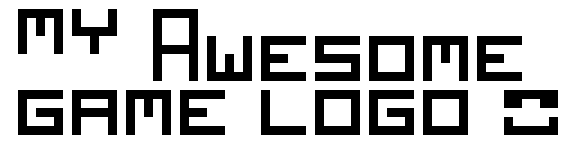

_NOTICE:_

This repo provides an awesome base structure to start develop a game of any size in raylib:
- `assets/` - for game assets, aka sounds, sprites, etc.
- `assets-src/` - project files for game assets, like .kra for krita for example
- `resources/` - files that are needed only during build and aren't used in game, like icons, .rc files, minshell.html
- `src/` - code of the game
- `src/include/` - for header files
- `CMakeLists.txt` - script to perform a flexible build, check and fetch dependencies, add platform and OS specific flags
- `Makefile` - wrapper around CMakeLists.txt to easily configure, build, run and clean project

Features:
- Optional `raylib` and `raygui` with configurable versions
- Ability to build for Windows and Linux both for Desktop and Web for Debug and Release
- Ability to configure game name, build and assets directories, game language (C or C++)
- Ability to set CMAKE_GENERATOR, CMAKE_C_COMPILE_LAUNCHER and CMAKE_CXX_COMPILE_LAUNCHER, change C and C++ standard
- `make help` with useful information

This template was inspired and relied a lot on the [official raylib gamejam template](https://github.com/raysan5/raylib-gamejam-template), tho it was almost entierely rethought and rewritten to make much more sense (at least for me), be easier to maintain and easier to scale.

### How to start with this template

1. On GitHub page find a button "Use this template" or install `github-cli` and run something like this:
    ```shell
    gh repo create -c -p https://github.com/infgotoinf/enjoy-raylib <YOUR-REPO-NAME> --public
    ```
2. Edit project information in the `Makefile`.
3. Then install [build dependencies](#build-dependencies).
4. And finally [build the project](#build-instructions).

Enjoy 😎 🤙

> [!IMPORTANT]
> After you are done making your game don't forget to edit `LICENSE` and this `README.md`, then delete this notice.

---
[](https://github.com/infgotoinf/hello-world/actions/workflows/build_linux.yml)
[](https://github.com/infgotoinf/hello-world/actions/workflows/build_windows.yml)
[](https://github.com/infgotoinf/hello-world/actions/workflows/build_webassembly.yml)

<!-- Then README.md is done delete everything above till here, incuding this comment -->


$(Game description)

$(Game screenshots)

_[](https://www.youtube.com/watch?v=VIDEO_ID)_
_[](https://www.youtube.com/watch?v=VIDEO_ID)_
_[itch.io Release](https://link)_
_[Steam Release](https://link)_

## Build dependencies

### Windows

You must install [MSYS2](https://www.msys2.org/) and launch **UCRT64** console in order to install dependencies and build the project:
```
pacman -S mingw-w64-ucrt-x86_64-gcc \
    mingw-w64-ucrt-x86_64-cmake mingw-w64-ucrt-x86_64-ninja make \
    mingw-w64-ucrt-x86_64-emscripten
```

> [!NOTE]
> You can use Raylib package unless you are on Windows. You need emscripten only if you build for the Web.

### Unix

#### Generic GNU/Linux

Follow [official raylib guide](https://github.com/raysan5/raylib/wiki/Working-on-GNU-Linux)

#### NixOS

```
nix-shell
```

#### MacOS

Follow [official raylib guide](https://github.com/raysan5/raylib/wiki/Working-on-macOS)

## Build instructions

To build the project on any platform:
```
make build
```

To run the project on any platform:
```
make run
```

To view build options:
```
make help
```

## Made with

### Librarries and other assets

- [Raylib](https://www.raylib.com/index.html): Zlib
- [Raygui](https://github.com/raysan5/raygui): Zlib
- [$(Dependency)](https://link): $(License)
- [$(Dependency)](https://link): $(License)

### Programs

- [Krita](https://krita.org/)
- [$(Program)](https://link)
- [$(Program)](https://link)

## Controls

| Key | Action |
|-----|--------|
| $(Key) | $(Action) |
| $(Key) | $(Action) |
| $(Key) | $(Action) |

## Developers

- [$(Developer)](https://link) - $(Role/Tasks developed)
- [$(Developer)](https://link) - $(Role/Tasks developed)
- [$(Developer)](https://link) - $(Role/Tasks developed)
